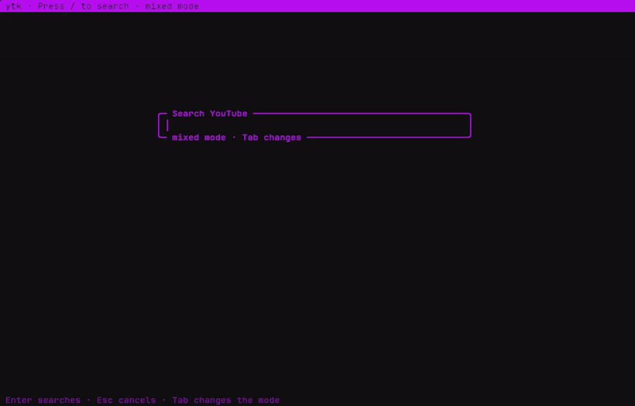

# ytk

[Español](README.es.md) · **English**

Search YouTube from the terminal and watch with mpv. Thumbnails are shown in a grid using kitty's graphics protocol
(it also works inside zellij). The interface comes in English and Spanish.



## Language

ytk starts in your system language (`$LANG`). Press `space L` to switch between English and Spanish instantly; the
choice is saved in `~/.local/state/ytk/lang`. `YTK_LANG=en` or `YTK_LANG=es` forces one (it takes priority).

## Installation

**Requirements:** [kitty](https://sw.kovidgoyal.net/kitty/) (or a terminal with its graphics protocol), `python3`
(3.9 or newer), [`yt-dlp`](https://github.com/yt-dlp/yt-dlp) and [`mpv`](https://mpv.io/). Optional: `python-pillow`
(if missing, thumbnails are converted with `ffmpeg`).

```sh
# Arch / Manjaro / Garuda
sudo pacman -S yt-dlp mpv kitty python-pillow

# Debian / Ubuntu
sudo apt install mpv kitty python3-pil ffmpeg && python3 -m pip install --user -U yt-dlp

# Fedora
sudo dnf install yt-dlp mpv kitty python3-pillow
```

**Install ytk** (nothing to build): clone the repo and link the launcher into a folder on your `PATH`.

```sh
git clone https://github.com/anton-arck/ytk.git ~/.local/share/ytk
mkdir -p ~/.local/bin && ln -sf ~/.local/share/ytk/bin/ytk ~/.local/bin/ytk
ytk --version
```

(Make sure `~/.local/bin` is in your `PATH`.) To stay on a specific version:
`git -C ~/.local/share/ytk checkout v0.3.1`; to update: `git -C ~/.local/share/ytk pull`. You can also download a
version's `.zip` from *Releases*, unpack it and run `bin/ytk` from there.

> **Heads up:** ytk relies on `yt-dlp`, which reads YouTube without an official API. When YouTube changes something it
> may stop working until a new `yt-dlp` is out: update it first (`yt-dlp -U`, or your package manager) before
> reporting a problem.

## Usage

```
ytk                      # opens; press / to search
ytk big buck bunny       # searches right away
```

**Leader key (like LazyVim):** `space` opens a menu that shows the options, and each letter is an action:

| Keys | Action |
|---|---|
| `space f` | search |
| `space m` → `m` / `v` / `l` | search mode: mixed, videos only, playlists only (repeats the current search) |
| `space o` | open a playlist, or a video's Mix |
| `space p` | play everything you are viewing (playlist or mix) |
| `space i` | video info: channel and subscribers, duration, views, likes, date, resolution and description |
| `space c` → `v` / `l` | open the video's channel: its videos or its playlists |
| `space L` | switch the interface language (English ⇄ español); it is saved |
| `space b` / `n` / `q` | back / more results / quit |

When searching (`space f` or `/`) a floating box appears, like LazyVim's: type, `Enter` searches, `Esc` cancels and
`Tab` changes the mode (the box shows which one is active).

In the info panel: `c` channel videos · `l` channel playlists · `Enter` play · `Esc` close. Inside a channel, `Tab`
toggles between its videos and its playlists, and `b` goes back.

`Esc` cancels the menu and `Backspace` goes up one level. The direct shortcuts below keep working.

Keys: arrows or `h j k l` move · `Enter` play (a playlist plays whole) · `o` open a playlist, or the **Mix** YouTube
generates from a video · `i` info · `c` channel · `P` play everything you are viewing (playlist or mix) ·
`Tab` changes the search mode · `b` back · `/` search · `n` more results · `g`/`G` start/end · `q` quit.

Search modes (`Tab`): **mixed** (videos with playlists mixed in, like the website; the default), **videos** and
**playlists**.

Variables: `YTK_HEIGHT` (max quality, 720 by default), `YTK_MPV_ARGS` (extra mpv options), `YTK_DOWNLOADS`
(downloads folder) and `YTK_LANG` (`es` or `en`). Thumbnails are cached in `~/.cache/ytk`; the mpv log is
`~/.cache/ytk/mpv.log`.

## Code layout

```
bin/ytk            launcher (also works as a symlink in ~/.local/bin)
ytk/
  cli.py           entry point: arguments, --help, --version
  i18n.py          interface languages (es/en): detection, preference and texts
  app.py           the App class: state, main loop and background loading
  keys.py          leader-key menu and key handling
  view.py          drawing: grid, info panel, menu and search box
  navigation.py    load sources, open playlists/channels/info, go back, change mode
  playback.py      mpv playback and control of the running mpv
  downloads.py     audio and video downloads
  youtube.py       yt-dlp queries (search, playlists, channels, video info)
  sources.py       where items come from (search, playlist, mix, channel, history)
  storage.py       history, saved position and downloaded files
  thumbs.py        thumbnail download and conversion
  terminal.py      terminal size, kitty graphics protocol and key reading
  text.py          widths, clipping and sanitising of external text
  config.py        constants and paths
```

Run it with `bin/ytk` or `python3 -m ytk` from the repo root. `probe/` has two small tests of kitty's image protocol.

`tools/record-demo.sh` records the demo GIF above by itself (sway + kitty + `wf-recorder` + `ffmpeg`): it opens a
floating kitty window, drives ytk through kitty's remote control and converts the recording to a small GIF. Search
results change over time, so adjust `-q` (what to search) and `-m` (cursor moves) if the selection does not land on a video.

## Continue watching

- Quitting mpv with `q` saves where you were (`--save-position-on-quit`, folder `~/.local/state/mpv/watch_later`);
  reopening the video resumes there.
- In the grid, videos with a saved position show `▶ 12:30/45:10` and a progress bar.
- `H` or `space h` opens the history (what you played last, up to 200), stored in `~/.local/state/ytk/history.json`.

## Downloads

- `space a` downloads the audio (opus, in `~/Videos/ytk/audio/`) and `space d` the video (mkv, in `~/Videos/ytk/`) of
  the selected video. It runs in the background; the status bar tells you when it finishes. Log: `~/.cache/ytk/dl.log`.
- Downloaded videos are marked with `⬇` and Enter plays the local file (no network, and it remembers where you left off).
- `YTK_DOWNLOADS` changes the folder.

## Skipping songs in a playlist

**From ytk** (without focusing mpv; ytk talks to it over a socket in `$XDG_RUNTIME_DIR`):
- `]` next song and `[` previous (also `space ]` and `space [`).
- With a playlist or Mix playing, open it in ytk (`o`), pick a song and press Enter: it jumps to that song in the same
  mpv, without opening another.

**Inside mpv** (with its window focused): `>` next, `<` previous, and `g` then `p` opens a filterable playlist picker
(type to search, arrows and Enter to choose).

## Versions and license

`ytk --version` shows the version. Each version's changes are in `CHANGELOG.md`; every version is a git tag
(`v0.3.1`…) and a download page under *Releases*. MIT license.
